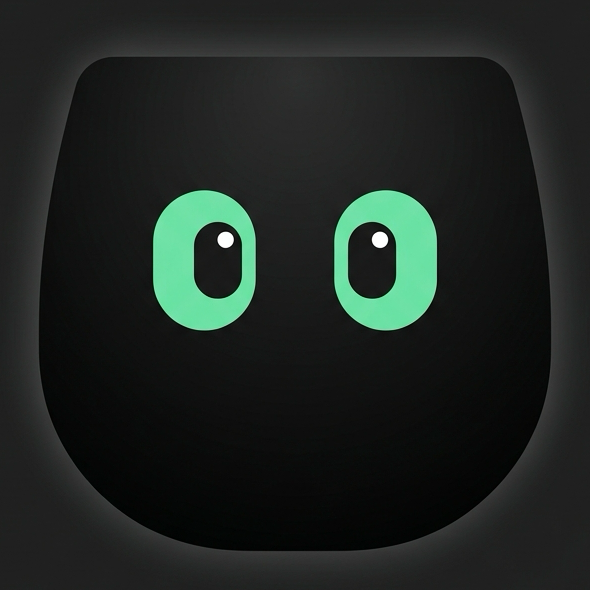

<div align="center">



# Notchii

**Turn your notch into a Swiss Army knife.**

Hover the notch on your MacBook and a panel drops out — tasks, a timer, a file
tray, playback controls, clipboard history. No window, no Dock icon.

[**Download**](https://notchii.xyz) · [notchii.xyz](https://notchii.xyz)

</div>

---

## Install

Grab the DMG from [notchii.xyz](https://notchii.xyz), drag Notchii into
Applications, and launch it once. The build is signed and notarised, so there is
no security warning to click past. There is no window — look for the mark in
your menu bar, then hover the notch.

Or build it yourself:

```bash
git clone https://github.com/seifotefa/Notchii.git
cd Notchii && make install
```

## Modes

| Mode | What it does |
| --- | --- |
| **Tasks** | A to-do list and a timer, side by side. Type a duration, press return, it runs. |
| **Tray** | Drag files onto the notch to park them; drag them out anywhere, or drop them on AirDrop. |
| **Music** | Artwork, playhead and transport for Spotify and Apple Music. |
| **Clipboard** | The last 20 things you copied. Click one to put it back. |
| **AI** | Up to five Claude, Codex, or Grok chats with running, blocked, and ready indicators. |

Every mode, and every piece inside a mode, switches off from the gear beside the
notch.

### AI status feed

The AI mode follows local Codex chats and Grok Bot conversations after you send
a message. It also reads `~/Library/Application Support/Notchii/ai-sessions.json`
every five seconds for other providers. A local integration can update this file
atomically with recent sessions. The feed does not contain credentials or chat messages:

```json
{
  "sessions": [
    {
      "id": "example-task-id",
      "provider": "codex",
      "title": "Fix search",
      "status": "running",
      "url": "codex://threads/example-task-id",
      "contextUsed": 12000,
      "contextLimit": 32000,
      "usage": "2h 15m remaining",
      "updatedAt": "2026-11-05T18:30:00Z",
      "lastSentAt": "2026-11-05T18:29:45Z"
    }
  ]
}
```

Providers are `claude`, `codex`, or `grok`; statuses are `running`, `blocked`,
`ready`, or `idle`. `url`, `contextUsed`, `contextLimit`, and `usage` are optional.
For feed integrations, set `lastSentAt` to the latest user message time. Refresh
`updatedAt` for status changes without changing `lastSentAt`.
For Grok Bot, set `title` to the bot's name.
Use an actual chat URL for one-click opening. Sessions older than two minutes
disappear, so the writer should refresh `updatedAt` while its source is active.
The small app bubble spins while running and shows the chat name, shows a warning
when blocked, and briefly becomes a green checkmark when ready. It then returns
to its app icon. Hovering reveals its name, plus context and usage when supplied.
Clicking opens the source chat. The five chat slots are saved across launches:
drag a bubble onto trash to remove it, leaving the slot empty until a new message
is sent in a chat outside the tray. Drag onto the pin to protect a chat from being
replaced when all five slots are full; drag it there again or right-click to unpin.
The AI gear in notch settings controls which providers appear.
Codex discovery is read-only and uses Codex's local thread database. Grok Bot
discovery reads its local roster and transcript snapshots, including each bot's
avatar shape and color; clicking its bubble activates Grok Bot. Claude still needs
a local feed writer. Context and account
usage are only shown when a provider supplies them.

## Requirements

macOS 13 or later, Apple silicon or Intel. Swift 5.9 to build.

## How it works

A borderless, non-activating `NSPanel` sits above the menu bar at the notch's own
rectangle. Hover is detected from the global cursor position rather than a
tracking area, so the panel never has to receive an event to notice you. Because
the panel is non-activating, typing in it does not deactivate the app you were
using.

```
Sources/Notchii
├── main.swift          accessory app entry point
├── AppDelegate.swift   wiring and the menu bar item
├── Theme.swift         layout constants and palette
├── Models/             stores and state, one file each
├── Notch/              geometry, panel, hover controller
└── Views/              one file per mode
```

State lives in `~/Library/Application Support/Notchii/`. Nothing leaves the
machine.

## Adding a mode

1. A case in `NotchModule`, and its pieces in `NotchComponent`
2. A SwiftUI view sized to `Layout.contentHeight`
3. A branch in `NotchRootView`

The switcher, the settings screen and the enable/disable plumbing pick it up from
there. Roughly thirty lines.

## Contributing

Issues and pull requests are welcome — bug reports especially.

Before opening a PR, please open an issue describing what you want to change so
the approach can be agreed first. Every PR is reviewed and merged at the
maintainer's discretion; nothing lands without approval. Keep changes focused,
match the surrounding style, and make sure `swift build` is clean.

The timer parsing check runs standalone:

```bash
swiftc -o /tmp/parsecheck Sources/Notchii/Models/FocusTimer.swift Tests/ParseCheck.swift && /tmp/parsecheck
```

## Releasing

```bash
make signing-check                     # certificate and notary profile
DEVELOPER_ID="..." NOTARY_PROFILE="..." make release VERSION=x.y.z
```

Builds a universal binary, wraps it in a DMG, then signs, notarises and staples
it. Without credentials it still produces an unsigned DMG.

## Licence

MIT — see [LICENSE](LICENSE).

Built by [Seif](https://seifotefa.com).
